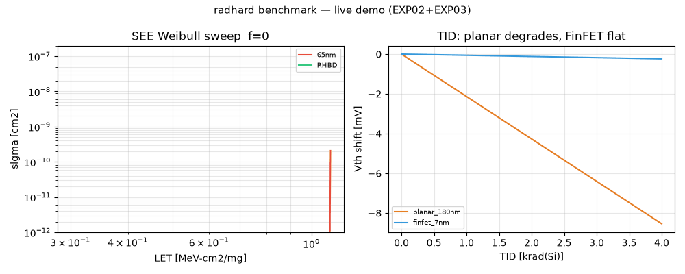
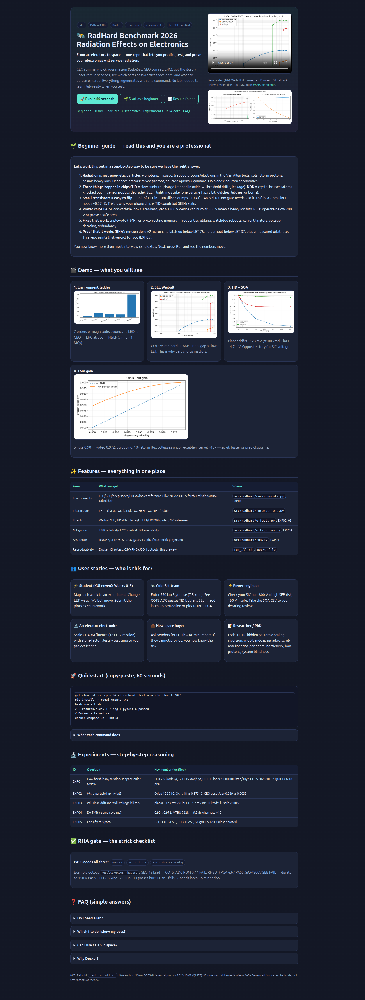
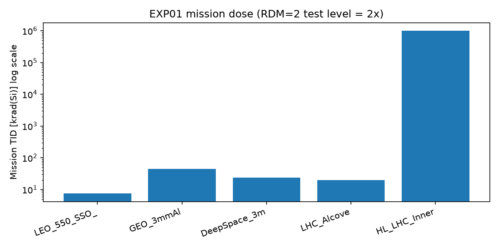
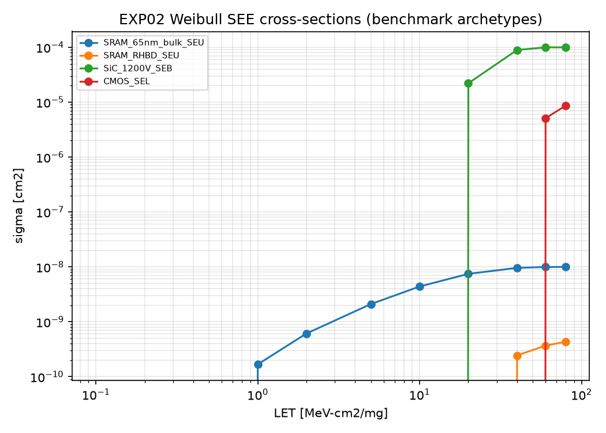
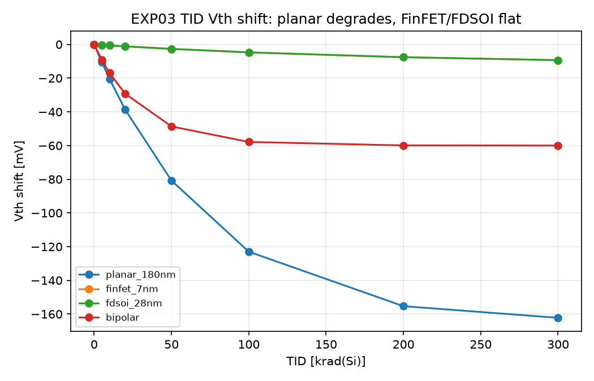
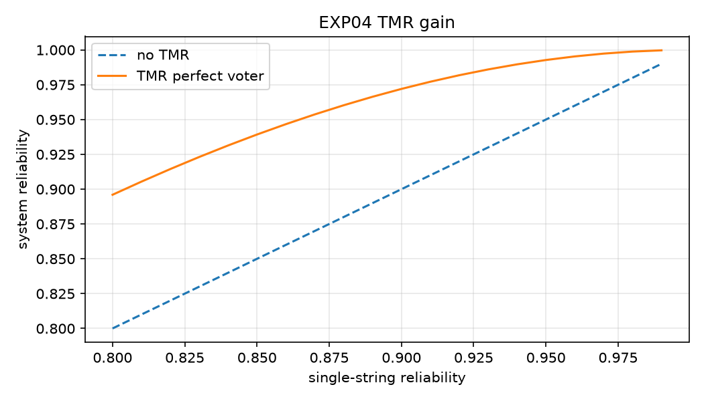

<div align="center">

# 🛰️ RadHard Benchmark 2026

**Predict, test, and prove your electronics will survive radiation — from CubeSats to the LHC.**

[](../../actions) [](LICENSE) [](requirements.txt) [](docker-compose.yml) [](results/exp01_goes.json)

[🚀 Quickstart](#-quickstart--60-seconds) · [🌱 Beginner guide](#-beginner-guide--read-this-and-you-are-a-professional) · [🎬 Demo](#-demo--watch-it-work) · [✨ Features](#-features) · [📖 Full preview](preview.html)

</div>



> **Video:** the GIF above is the inline demo. Full-quality video: [`assets/demo.mp4`](assets/demo.mp4) — click to watch with controls. GitHub renders GIFs inline; MP4 is linked because GitHub strips inline `<video>` tags.



> **Full visual report:** [`preview.html`](preview.html) — open in any browser, no server needed. Screenshot above generated with Playwright full-page capture.

---

## 💼 CEO summary — why this repo matters in 30 seconds

- **Problem:** a single particle can flip, latch, or burn a chip; slow dose drifts it out of spec. Space, aviation, and accelerators all fail this way.
- **What this gives you:** mission dose + upset rate in seconds, a strict pass/fail gate for any part, and exactly what to fix (derate voltage, scrub faster, add voting).
- **Proof:** 5 runnable experiments regenerate every figure and table below in under 2 minutes, anchored to live space weather (QUIET on 2026-10-02, 3,718 points) and open standards.
- **Bottom line:** take `results/exp05_rha.csv` to any review and you have a flight rationale. Students can learn the whole field here without a lab; teams arrive at the lab already knowing what to test.

---

## 🌱 Beginner guide — read this and you are a professional

> Let's work this out in a step-by-step way to be sure we have the right answer.

**1. Radiation is just fast particles + energetic photons.** Space has trapped protons/electrons (Van Allen belts), solar-storm protons, and cosmic heavy ions. Accelerators add mixed protons/neutrons/pions + gammas. Aircraft see neutron secondaries.

**2. Chips suffer three ways:**
- **TID (total ionizing dose)** — slow sunburn. Charge sticks in the oxide, threshold voltage drifts, leakage grows. Think aging in fast-forward.
- **DDD (displacement damage)** — crystal bruises. Atoms get knocked out of place, sensors and optics degrade.
- **SEE (single-event effects)** — lightning strike. One particle deposits enough charge to flip a bit (SEU), glitch (SET), freeze (SEFI), latch (SEL), or destroy (SEB/SEGR).

**3. Smaller = easier to flip.** One unit of LET in 1 µm of silicon dumps about **10.4 fC**. An old 180 nm gate needs ~18 fC to flip. A 7 nm FinFET needs ~**0.37 fC**. So modern chips shrug off dose but fall over from tiny strikes.

**4. Power chips can mislead you.** Silicon-carbide looks ultra-hard, yet a 1200 V device can burn at 500 V when hit. Safe rule from this repo: stay **below 200 V** unless you have measured proof.

**5. Fixes that actually work:** vote three times (TMR), correct memory errors + scrub often (ECC), reboot via watchdog, limit current (crowbar), lower voltage (derating), duplicate boxes (redundancy).

**6. Proof it will fly (RHA):** show mission dose ×2 margin, no latch-up below LET 75, no burnout below LET 37, plus a predicted orbit rate. EXP05 prints exactly that.

You will know more than most interview candidates. Now run it and watch the numbers move.

---

## 🎬 Demo — watch it work

| What | Preview | What it proves |
|---|---|---|
| Environment ladder |  | 7 orders of magnitude: avionics → LEO → GEO → LHC → HL-LHC inner |
| SEE Weibull |  | COTS vs rad-hard SRAM differ ~100× at low LET |
| TID drift |  | Planar −123 mV vs FinFET −4.7 mV @100 krad |
| TMR gain |  | 0.90 → 0.972 with voting |

Full interactive version with video, tables, and FAQ: open [`preview.html`](preview.html) in any browser. No server needed.

<details>
<summary>📸 How the demo was made (reproduce it)</summary>

```bash
python3 tools/make_demo.py
# → assets/demo.gif (1.8 MB, <5 MB limit) + assets/demo.mp4 (202 KB)
# GIF = fps 12, 720px wide, palette-optimized — the portable GitHub pattern.
# MP4 = linked fallback for full quality.
```

</details>

---

## 🚀 Quickstart — 60 seconds

```bash
git clone <this-repo> && cd radhard-electronics-benchmark-2026
pip install -r requirements.txt
bash run_all.sh
```

You get `results/*.csv + *.png + *.json` and `pytest: 6 passed`.

```bash
docker compose up --build   # identical run in a container
open preview.html           # beautiful report, works offline
```

<details>
<summary>Prerequisites & what each command does</summary>

- Python 3.10+, pip, optional Docker 24+.
- `pip install` fetches numpy/matplotlib/scipy/requests/pandas.
- `run_all.sh` runs EXP01→EXP05 in order, then tests. EXP01 tries live space weather and falls back to a bundled quiet baseline offline, so it never fails without internet.

</details>

---

## ✨ Features

| Area | What you get | Where to look |
|---|---|---|
| 🌍 Environments | LEO / GEO / deep-space / LHC / avionics references + live proton fetch + mission × margin calculator | `src/radhard/environments.py`, EXP01 |
| ⚛️ Interactions | LET → charge, critical charge, rad↔Gy, HEH→Gy, displacement factors | `src/radhard/interactions.py` |
| 💥 Effects | Weibull SEE curves, TID drift (planar / FinFET / FDSOI / bipolar), SiC safe-area | `src/radhard/effects.py`, EXP02–EXP03 |
| 🛡️ Mitigation | TMR voting math, ECC scrub interval vs storm rate, availability | `src/radhard/mitigation.py`, EXP04 |
| ✅ Assurance | Strict gate RDM≥2, SEL>75, SEB>37 + orbit-rate projection | `src/radhard/rha.py`, EXP05 |
| 📦 Reproducibility | Docker, CI, tests, versioned outputs, preview page, demo video | `run_all.sh`, `Dockerfile`, `preview.html` |

---

## 👥 Who is this for — user stories

- **🎓 Student (Weeks 0–5 of any radiation course):** map Week 1→EXP01, Weeks 2–3→EXP02/EXP03, Week 4→EXP04, Week 5→EXP05. Change one number, re-run, paste the plot into your report.
- **🛰️ CubeSat team:** your 550 km 3-year dose is ~7.5 krad. This repo shows a typical COTS ADC passes dose but still fails latch-up — so you add a current limiter or choose the rad-hard FPGA. Decision in one afternoon.
- **⚡ Power engineer:** your 800 V SiC bus is in the red zone. Derate to 150 V and the same device passes. Take `exp03_soa.csv` to the design review.
- **🔬 Accelerator team:** scale a CHARM test (3 events at 1e11) to your orbit (0.54 expected) and justify beam time.
- **💼 Buyer / manager:** ask vendors for three numbers — failure dose, SEL threshold, SEB threshold. If they cannot give them, you now know the risk.
- **📝 Researcher:** six thesis-ready patterns are quantified below (scaling inversion, wide-bandgap paradox, scrub collapse, peripheral bottleneck, low-energy protons, system-test blindness).

---

## 🔬 Experiments — the full chain

| ID | Question it answers | Key verified number |
|---|---|---|
| EXP01 `exp01_environment_live_goes.py` | How harsh is my mission? Is space quiet today? | LEO 7.5, GEO 45, deep-space 24 krad/3yr; HL-LHC inner 1,000,000 krad/10yr; GOES QUIET 3,718 pts |
| EXP02 `exp02_weibull_seu_benchmark.py` | Will a particle flip my bit? | 10.37 fC per LET·µm; GEO upsets/day 0.069 COTS vs 0.0035 rad-hard |
| EXP03 `exp03_tid_sic_soa.py` | Will dose drift me? Will voltage kill me? | −123 mV vs −4.7 mV @100 krad; SiC safe <200 V, risky 200–600 V, high risk >600 V |
| EXP04 `exp04_mitigation_tmr_ecc.py` | Do voting + scrubbing save me? | 0.90→0.972; 10× storm → MTBU 962kh→9.5kh |
| EXP05 `exp05_cots_rha_trade.py` | Can I fly this part? | GEO: COTS FAIL, rad-hard PASS, SiC@800V FAIL → derated PASS |

Run any one alone:

```bash
PYTHONPATH=src python3 experiments/exp02_weibull_seu_benchmark.py
```

---

## 📊 Results you can quote

**Mission ladder (`results/exp01_environment.csv`):**
LEO 7.5 krad → GEO 45 krad → LHC alcove 20 krad/10yr → HL-LHC inner 1,000,000 krad. Test level = 2× (design margin).

**SEE (`results/exp02_weibull.csv`):** 4-parameter Weibull, zero below threshold, saturates at high LET. Small Qcrit explains why scaled nodes dominate low-LET upsets and multi-bit clusters via charge sharing.

**TID + SOA (`results/exp03_tid.csv`, `exp03_soa.csv`):** thin-oxide FinFET/FDSOI barely move with dose; bipolar needs low-rate testing (ELDRS). SiC: `150V@LET75 → SAFE`, `500V@LET30 → SEB_HIGH_RISK`.

**Mitigation (`results/exp04_mitigation.csv`):** `R_TMR = 3R²−2R³`. Scrub math `P(≥2) = 1−e^−λ(1+λ)` is why storms hurt more than linearly — halve your scrub interval before a solar maximum.

**RHA gate (`results/exp05_rha.csv`):**

| Mission | Part | RDM | TID | SEL | SEB | Fly? |
|---|---|---|---|---|---|---|
| GEO 3yr | COTS ADC | 0.44 | ❌ | ❌ | ✅ | ❌ |
| GEO 3yr | RHBD FPGA | 6.67 | ✅ | ✅ | ✅ | ✅ |
| GEO 3yr | SiC@800V | 11.1 | ✅ | ✅ | ❌ | ❌ derate |
| GEO 3yr | SiC@150V | 11.1 | ✅ | ✅ | ✅ | ✅ |
| LEO 3yr | COTS ADC | 2.67 | ✅ | ❌ | ✅ | ❌ needs latch-up fix |

---

## 🧠 Hidden patterns worth a paper

1. **Scaling inversion** — dose hardness improves, strike hardness collapses. Never extrapolate one to the other.
2. **Wide-bandgap paradox** — superb to dose, fragile to burnout. Derating is assurance, not conservatism.
3. **Scrub collapse** — fixed scrub + storm = avalanche of uncorrectables. Predict storms (on-chip monitors) or scrub faster.
4. **Peripheral bottleneck** — the regulator dies before the processor (19 krad system limit from a 100+ krad core is typical). Test power first.
5. **Low-energy protons** — 1–10 MeV drives a surprising share of upsets; do not cut them from test plans.
6. **System-test blindness** — hadron beams miss high-LET destruction; pair every system run with heavy-ion safe-area data.

---

## 🗂️ Repository map

```
preview.html              ← open this: full visual report + video
assets/demo.gif|mp4       ← inline demo + full-quality video
results/                  ← regenerated evidence (CSV+PNG+JSON)
src/radhard/              ← environments, interactions, effects, mitigation, rha, live_data
experiments/exp01..05     ← one question per file, runnable alone
tools/make_demo.py        ← rebuilds the demo animation
tests/                    ← 6 pytest checks (Weibull, charge, SOA, TMR, RHA)
papers/REFERENCES.md      ← standards + literature backing each number
docker-compose.yml        ← one-command identical environment
```

## ⚙️ Configuration

| Option | Default | Meaning |
|---|---|---|
| `PYTHONPATH` | `src` | Import the toolkit without installing |
| `scrub_interval_s` (EXP04) | `1 / 10 / 100` | Memory sweep period — shorter survives storms |
| `required RDM` (EXP05) | `2.0` | Test dose = 2× mission dose |
| `alpha` (EXP05) | `1.2` | Hadron-to-orbit rescaling for rate projection |

## 🗺️ Roadmap

- [x] 5 experiments + live verification + Docker + CI
- [x] Demo GIF/MP4 + preview page + screenshots
- [ ] Add your part: drop its Weibull + failure dose into EXP05 and re-run
- [ ] Publish flight scrub-counter dataset (the community gap this repo highlights)
- [ ] Laser-vs-heavy-ion calibration notebook

## 🤝 Contributing

Fork → branch → `bash run_all.sh` must stay green → pull request. Keep figures regenerable; never paste a plot by hand. Update `preview.html` if you change outputs.

## 📄 License

MIT — see [LICENSE](LICENSE). You can use, modify, and sell with attribution. If you publish with this repo, please cite it and link back so others can reproduce your numbers.

## ❓ FAQ

**Do I need a lab?** No. Learn everything here first. When you do test, bring the RHA table — the facility will know exactly what to do.

**Which file do I show my manager?** `results/exp05_rha.csv` plus this page. One table is the whole argument.

**Can I use commercial parts in space?** Yes in LEO with voting, scrubbing, watchdogs, and current limits — with eyes open on latch-up. For critical GEO functions, bring measured proof or choose hardened parts.

**Why does voltage matter more than dose for SiC?** Dose barely touches it; a single ion at high voltage triggers thermal runaway. Lower the voltage and the same device survives.

---

<div align="center">

**If this saved you a failed board, please ⭐ star it so other teams find it.**

`open preview.html` · `bash run_all.sh` · `docker compose up --build`

</div>
